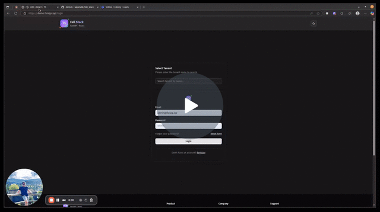

# Full-Stack FastAPI React Multi-Tenancy Template

A modern full-stack Multi-tenant application template featuring a FastAPI backend with Clean Architecture, React frontend with TypeScript, and comprehensive tooling for development and deployment.

## ✨ Key Features

This full-stack template provides enterprise-ready features out of the box:

### 🔐 User Management
- **Authentication & Authorization**: JWT-based authentication with refresh tokens
- **User Registration**: Self-registration with email verification
- **Profile Management**: Complete user profile with image upload support
- **Account Management**: User activation, deactivation, and role assignment
- **Password Management**: Secure password reset and update functionality
- **Passkeys Management**: Passkeys and management
- **Magic link**: Passwordless login via Magic link
- **Configurable SSO**: Configure SSO

### 🏢 Tenant Management
- **Multi-tenancy Support**: Isolated data and resources per tenant
- **Tenant Search**: Advanced search functionality by name and subdomain
- **Tenant Administration**: Create, update, and manage tenant configurations
- **Subdomain Routing**: Custom subdomain support for each tenant
- **Custom Domain Routing**: Bring your own domain

### 👥 Role Management
- **Role-Based Access Control (RBAC)**: Granular permission system
- **Dynamic Roles**: Create and manage custom roles with specific permissions
- **Role Assignment**: Assign roles to users within tenant contexts
- **Permission Matrix**: Fine-grained control over feature access

### ☁️ Cloud Storage Integration
- **Azure Blob Storage**: Native integration with Azure cloud storage
- **AWS S3 Compatible**: Full S3 API compatibility for file storage
- **File Upload Management**: Secure file upload with validation and processing
- **Storage Abstraction**: Seamless switching between storage providers

### 🤖 AI Chat Interface
- **Local AI Models**: Integration with locally installed AI models
- **Real-time Streaming**: Live response streaming for better user experience
- **Chat History**: Persistent conversation history and management
- **Model Selection**: Dynamic switching between different AI models
- **Responsive Design**: Mobile-optimized chat interface

### 💳 Stripe Payment Integration
- **Payment Gateway Configuration**: Easy Stripe API and webhook setup
- **Product Management**: Create and manage products with CRUD operations
- **Billing Plans**: Flexible plan creation with monthly/yearly intervals
- **Trial Periods**: Toggle trial periods for any plan (default 14 days)
- **Invoice Management**: Comprehensive invoice listing and tracking
- **Checkout Sessions**: Billing record management with pagination
- **Multi-Currency Support**: Accept payments in multiple currencies
- **Subscription Management**: Handle one-time and recurring payments

### 🎛️ Feature Management
- **Feature Toggles**: Enable/disable features per tenant
- **Dynamic Feature Control**: Real-time feature activation/deactivation
- **Visual Feature Dashboard**: Intuitive interface for feature management (Comming soon!)
- **Granular Permissions**: Control feature access at tenant level

### 🏠 Tenant Experience
- **Custom Branding**: Tenant-specific configurations and settings (Coming soon!)
- **Inactive Tenant View**: Professional inactive account messaging
- **DNS Configuration**: Step-by-step custom domain setup
- **Tenant Settings**: Comprehensive tenant information management

### Coolify Integration
- **Domain Mapping**: Assign domain easily with Coolify app
- **Deployment**: Auto deploy when new domain added.
- **Toggle on/off**: Via env


## Watch Demo



[Check out deployed DEMO Version](https://demo.fsrapp.xyz/)

### Login as Host

Use the following credentials to log in as the **host administrator**:

| Username                        | Password   |
|----------------------------------|------------|
| admin@fsrapp.xyz | Test@123! |

---

### Login as Tenant

To log in as a **tenant admin**:

1. On the login page, search a **dentally** tenant from the search field.  
2. Then enter the credentials below:

| Username            | Password       |
|----------------------|----------------|
| admin@dentally.nl    | Dentally@123!  |

### Login as a Tenant User

1. First, create a new user while logged in as the **Tenant Admin**.  
2. After creating the user, **log out** from the admin account.  
3. Finally, **log in** again using the newly created user's credentials.


## 🏗️ Architecture Overview

This project follows a **Clean Architecture** pattern with clear separation between backend and frontend, designed for scalability, maintainability, and testability.

### Technology Stack

**Backend:**
- **FastAPI** - Modern Python web framework
- **MongoDB** - NoSQL database with Beanie ODM
- **Redis** - Caching and message broker
- **Celery** - Asynchronous task processing
- **JWT** - Authentication and authorization
- **LangChain** - AI/ML integration capabilities

**Frontend:**
- **React 18** - Modern UI library
- **TypeScript** - Type-safe JavaScript
- **Vite** - Fast build tool
- **Tailwind CSS** - Utility-first CSS framework
- **shadcn/ui** - High-quality React components
- **React Hook Form** - Form handling with validation

**Infrastructure:**
- **Docker** - Containerization
- **Docker Compose** - Development environment orchestration
- **Helm** - Kubernetes deployment charts

## 📁 Project Structure

```
full_stack_fastapi_react_template/
├── backend/                    # FastAPI backend application
│   ├── api/                   # Clean Architecture layers
│   │   ├── common/           # Shared utilities and constants
│   │   ├── core/             # Core business logic
│   │   ├── domain/           # Domain models and entities
│   │   ├── infrastructure/   # External services integration
│   │   ├── interfaces/       # API controllers and routes
│   │   └── usecases/         # Application use cases
│   ├── tests/                # Test suite
│   ├── .env.example          # Environment variables template
│   ├── Dockerfile            # Container configuration
│   ├── Makefile              # Development commands
│   ├── pyproject.toml        # Python dependencies and config
│   └── requirements.txt      # Python dependencies (fallback)
│
├── frontend/                  # React frontend application
│   └── app/                  # Main application code
│       ├── src/
│       │   ├── api/          # Auto-generated API client
│       │   ├── components/   # React components
│       │   │   ├── features/ # Feature-specific components
│       │   │   ├── layouts/  # Layout components
│       │   │   ├── providers/# Context providers
│       │   │   ├── shared/   # Reusable components
│       │   │   └── ui/       # shadcn/ui components
│       │   ├── hooks/        # Custom React hooks
│       │   ├── lib/          # Utility functions
│       │   └── assets/       # Static assets
│       ├── public/           # Public static files
│       ├── package.json      # Node.js dependencies
│       ├── vite.config.ts    # Vite configuration
│       └── components.json   # shadcn/ui configuration
│
├── infra/                     # Infrastructure and deployment
│   └── helm/                 # Kubernetes Helm charts
│       ├── templates/        # Kubernetes manifests
│       ├── Chart.yaml        # Helm chart metadata
│       └── values.yaml       # Default configuration values
│
└── dev.compose.yaml          # Docker Compose for development
```

## 🔧 Backend Architecture

The backend follows **Clean Architecture** principles with clear layer separation:

### Layer Structure

- **Domain Layer** (`domain/`): Core business entities and rules
- **Use Cases Layer** (`usecases/`): Application-specific business logic
- **Interface Adapters** (`interfaces/`): API controllers, presenters
- **Infrastructure Layer** (`infrastructure/`): External services, databases, message queues
- **Common Layer** (`common/`): Shared utilities, constants, and configurations

### Key Features

- **Authentication & Authorization**: JWT-based with refresh tokens, Passkey and Magic Link
- **Database**: MongoDB with Beanie ODM for async operations
- **Caching**: Redis for performance optimization
- **Background Tasks**: Celery with Redis broker
- **Email**: SMTP integration with async mail sending
- **AI Integration**: LangChain for AI/ML capabilities
- **Stripe Integration**: Complete payment gateway with products, plans, and subscriptions
- **API Documentation**: Auto-generated OpenAPI/Swagger docs
- **Testing**: Comprehensive test suite with pytest

### Dependencies Management

- **uv**: Fast Python package installer and resolver
- **pyproject.toml**: Modern Python dependency specification
- **Virtual Environment**: Isolated Python environment in `.venv/`

## 🎨 Frontend Architecture

The frontend is built with modern React patterns and TypeScript for type safety:

### Component Organization

- **Features** (`components/features/`): Business logic components
  - **Auth**: Login, registration, password reset, passkey, and magic link authentication
  - **Profile**: User profile management with image upload
  - **Chat**: AI chat interface with streaming responses
  - **Tenant**: Tenant management, settings, and feature toggles
  - **Billings/Stripe**: Complete payment gateway integration
    - Stripe configuration and settings
    - Product management (CRUD operations)
    - Billing plan creation and management
    - Invoice listing and tracking
    - Checkout session overview
    - Trial period management
- **Layouts** (`components/layouts/`): Page layout components (dashboard, default)
- **Providers** (`components/providers/`): React context providers for global state
- **Shared** (`components/shared/`): Reusable components across features
- **UI** (`components/ui/`): Low-level shadcn/ui components

### Key Features

- **Type Safety**: Full TypeScript integration
- **Component Library**: shadcn/ui for consistent design system
- **Form Handling**: React Hook Form with Zod validation
- **Routing**: React Router for client-side navigation
- **State Management**: React Context for global state
- **Styling**: Tailwind CSS with responsive design
- **API Integration**: Auto-generated client from OpenAPI specs
- **Payment Integration**: Complete Stripe payment gateway components
- **Feature Management**: Dynamic feature toggle interface
- **Professional UI**: Modern card-based layouts with proper loading states

### Build System

- **Vite**: Fast development server and build tool
- **ESLint**: Code linting and formatting
- **TypeScript**: Compile-time type checking
- **pnpm**: Efficient package management

## 🐳 Development Environment

### Stripe Payment Integration Setup

To use the Stripe payment features, you need to configure your Stripe account:

1. **Get Stripe API Keys**:
   - Sign up at [Stripe Dashboard](https://dashboard.stripe.com)
   - Get your API keys from Developers → API keys
   - Get your webhook secret from Developers → Webhooks

2. **Configure Stripe in Application**:
   - Navigate to Stripe Configuration page in the app
   - Enter your Stripe Secret Key
   - Enter your Webhook Secret
   - Set default currency (e.g., USD, EUR)
   - Choose payment mode (one-time, recurring, or both)
   - Set trial period days (optional)

3. **Create Products and Plans**:
   - Navigate to Products page to create your offerings
   - Use "Add a Plan" to create pricing plans
   - Toggle trial periods for any plan
   - Monitor billing through the Billing Overview dashboard

### Prerequisites

- Python 3.13+
- Node.js 22+
- Docker & Docker Compose
- pnpm (recommended) or npm
- Git

### Getting Started

1. **Clone the Repository**:
   ```bash
   git clone https://github.com/sajanv88/full_stack_fastapi_react_template.git
   cd full_stack_fastapi_react_template
   ```

### Environment Setup

1. **Backend Environment**:
   ```bash
   cp backend/.env.example backend/.env
   ```
   
   Edit `backend/.env` with your configuration:

   ```bash
        # MongoDB settings
        MONGO_URI=mongodb://127.0.0.1:27012
        MONGO_DB_NAME=full_stack_fastapi_react_template

        # JWT settings
        JWT_SECRET=your_jwt_secret_key
        REFRESH_TOKEN_SECRET=your_refresh_jwt_secret_key

        # Configure your default app admin credentials.
        ADMIN_EMAIL=admin@example.com
        ADMIN_PASSWORD=Test@123!

        # SMTP Email settings
        SMTP_HOST="localhost"
        SMTP_PORT=1023
        SMTP_USER=""
        SMTP_PASSWORD=""
        SMTP_MAIL_FROM=noreply@example.com
        SMTP_MAIL_FROM_NAME="Full-Stack Fast API"
        SMTP_STARTTLS=False
        SMTP_SSL_TLS=False
        SMTP_USE_CREDENTIALS=False
        SMTP_VALIDATE_CERTS=False

        # Redis settings

        REDIS_URI="redis://localhost:6372/0"

        # Celery settings
        CELERY_BROKER_URL="redis://localhost:6372/0"
        CELERY_RESULT_BACKEND="redis://localhost:6372/0"

        # App configuration
        APP_TITLE="Full-Stack FastAPI React Template"
        APP_VERSION="0.1.0"

        API_ENDPOINT_BASE="http://localhost:8000/api"

        # Configure Multi-Tenancy
        MULTI_TENANCY_STRATEGY="header"

        # Host main domain name
        HOST_MAIN_DOMAIN="fsrapp.com"

        # Environment
        FASTAPI_ENV="development"  # Options: "development", "production"

        # Ollama settings
        OLLAMA_HOST="http://localhost:11434"
      
        # Coolify settings for deployment
         COOLIFY_ENABLED="false" # Set to "true" to enable Coolify integration
         COOLIFY_API_URL="https://{replace_with_your_coolify_instance_endpoint}/api/v1"
         COOLIFY_API_KEY="{replace_with_your_coolify_api_key}" # Read here https://coolify.io/docs/api-reference/authorization
         COOLIFY_APPLICATION_ID="{replace_with_your_coolify_application_id}" # Read here https://coolify.io/docs/api-reference/api/operations/get-application-by-uuid


         # Default aws s3 settings for file uploads this belongs to the Host
         AWS_REGION="eu-central-1"
         AWS_ACCESS_KEY_ID="Ab..."
         AWS_SECRET_ACCESS_KEY="xxe..."
         AWS_S3_BUCKET_NAME="fs.."

         # Stripe credentials settings
         STRIPE_API_KEY="rk_test_5..."
         STRIPE_PUBLISHABLE_KEY="pk_test_5..."
         STRIPE_SECRET_KEY="sk_test_$..."

   ```

2. **Start Infrastructure Services**:
   ```bash
   docker-compose -f dev.compose.yaml up -d
   ```
   This starts:
   - MongoDB (port 27012)
   - Redis (port 6372)
   - Fake SMTP Server (ports 1023, 1083)
   - Caddy proxy for local development ssl. Useful for testing passkey login in local development.

3. **Backend Development**:
   ```bash
   cd backend
   uv sync                      # Install dependencies
   uv run fastapi dev api        # Start development server
   ```

4. **Frontend Development**:
   ```bash
   cd frontend/app
   pnpm install              # Install dependencies
   pnpm dev                  # Start development server
   ```

### Available Services

- **Backend API**: http://localhost:8000
- **Frontend App**: http://localhost:5173
- **API Documentation**: http://localhost:8000/docs
- **MongoDB**: localhost:27012
- **Redis**: localhost:6372
- **Fake SMTP UI**: http://localhost:1083

### Available Features in UI

Once you have the application running, you can access the following features:

**Authentication & User Management:**
- Login with email/password
- Passkey authentication (WebAuthn)
- Magic link authentication
- User registration and profile management
- Password reset functionality

**Tenant Management:**
- Tenant settings and configuration
- Custom domain DNS setup
- Feature toggle management
- Inactive tenant view with support information

**Stripe Billing & Payments:**
- Stripe configuration interface
- Product management (create, edit, delete)
- Billing plan creation with trial periods
- Billing overview dashboard
- Invoice listing and management
- Checkout session tracking

**AI Chat:**
- Real-time AI chat interface
- Chat history management
- Model selection

**Dashboard:**
- Overview of key metrics
- Quick access to all features
- Responsive design for mobile and desktop

## 🔄 Integration & Workflow

### API Client Generation

The frontend automatically generates TypeScript API clients from the backend's OpenAPI specification:

```bash
cd frontend/app
pnpm run generate:api
```

This creates type-safe API clients in `src/api/` directory.

### Development Workflow

1. **Backend First**: Define API endpoints and models
2. **Generate Client**: Update frontend API client
3. **Frontend Integration**: Use generated clients in React components
4. **Type Safety**: TypeScript ensures end-to-end type safety

### Background Tasks

Start Celery worker for background processing:

```bash
cd backend
make worker          # Start Celery worker (It is required for post tenant creation process)
make flower          # Start Flower monitoring UI
```

## 🚀 Deployment

### Docker Deployment

Each service includes production-ready Dockerfiles:

- **Backend**: Multi-stage build with Python optimization
- **Frontend**: Static build served by backend. 

### Kubernetes Deployment

Helm charts provided in `infra/helm/` for Kubernetes deployment:

```bash
cd infra/helm
helm install my-app . -f values.yaml
```

## 🔧 Configuration

### Backend Configuration

Environment variables in `backend/.env`:
- Database connections (MongoDB, Redis)
- JWT secrets and security settings
- SMTP email configuration
- Admin user credentials
- Feature flags and API settings

### Frontend Configuration

Configuration in `frontend/app/`:
- `vite.config.ts`: Build and development settings
- `components.json`: shadcn/ui component configuration
- `tsconfig.json`: TypeScript compiler options

## 🧪 Testing

### Backend Testing

The tests need MongoDB and Redis, the ones from `dev.compose.yaml` are enough. They use a dedicated
database (`api_test_db`) and Redis database (`15`), and never read your `.env`.

```bash
docker compose -f dev.compose.yaml up -d mongodb redis
cd backend
uv run pytest                # Run all tests
uv run pytest tests/interfaces/  # Run API tests
```

`backend/openapi.json` is the API contract that `frontend/app/src/api` is generated from, and a test
fails when the API drifts from it. After an intended change, update it and regenerate the client:

```bash
UPDATE_OPENAPI=1 uv run pytest tests/interfaces/test_openapi_snapshot.py
```

### Frontend Testing

```bash
cd frontend/app
pnpm build                   # Type check and build for production
```

## 📚 Additional Resources

- **Backend API Docs**: Visit `/docs` endpoint when running
- **Component Storybook**: shadcn/ui component documentation
- **Architecture Decisions**: See individual README files in `backend/` and `frontend/app/`

## 🤝 Contributing

1. Follow the established folder structure
2. Maintain Clean Architecture principles in backend
3. Use TypeScript for all frontend code
4. Add tests for new features
5. Update API client after backend changes

If you like this project, please consider supporting me on, [Ko-fi!](https://ko-fi.com/sajanvtech) Your support helps cover maintenance and server costs. I truly appreciate it 🙏 
---

This template provides a solid foundation for building modern, scalable full-stack applications with clear separation of concerns and comprehensive tooling.
